# 🚕 TaxiFlow — MLOps Pipeline Orchestrated with Apache Airflow

> End-to-end **MLOps** pipeline that predicts **NYC taxi trip durations**, with integrated **Data Quality gates**, **Spark MLlib training**, **Champion / Challenger deployment**, **Data Drift Monitoring** and **Data Lineage Tracking**.

---

### ⚠️ The Problem: Models That Silently Degrade

A machine learning model is only as good as the data it is trained on. In a real production setting, new data arrives every month — and nothing guarantees that it is clean or that it still looks like the data the model learned from:

- A **corrupted upstream batch** (negative fares, zero distances, trips that end before they start) can be used to retrain the model and **silently replace a good model with a bad one**.
- A **change in behaviour** (traffic, seasons, new habits) makes predictions drift, without any error being raised.
- When a number looks wrong on a dashboard, teams have **no visibility into where the data came from** or which step produced it.

### 🌟 How TaxiFlow Solves It

TaxiFlow automates the full lifecycle of a model, one month of data at a time, with a **defense-in-depth** approach:

1. **Preventive Quality Gate** — every month is validated with **Great Expectations** (18 rules) *before* any training. A corrupted month stops the pipeline.
2. **Reproducible Training** — two **Spark MLlib** models (Linear Regression and Gradient Boosted Trees) are trained and tracked in **MLflow**.
3. **Safe Deployment (Champion / Challenger)** — a new model is promoted to production **only if it beats the current champion** on the same test set.
4. **Drift Monitoring** — **Evidently** compares each new month with the data the production model was trained on and raises an alert when it changes too much.
5. **End-to-End Lineage** — **OpenLineage + Marquez** trace every dataset from the NYC open data source down to the predictions and reports.

### 💼 Why This Matters

Moving data from A to B is not enough. This project demonstrates how to build a pipeline that is **automated, tested, versioned, monitored and auditable** — the core principles of MLOps and DataOps:

- **Trust the data** before using it (quality gates).
- **Never degrade production** (champion / challenger with a minimum improvement threshold).
- **Detect problems early** (drift alerts) and **find their origin fast** (lineage graph).

## 🧱 Technology Stack

**Orchestration**


**Data Processing & Machine Learning**


**Data Quality & Observability**


**Visualization & Core**


---

## 🏗️ Architecture Overview

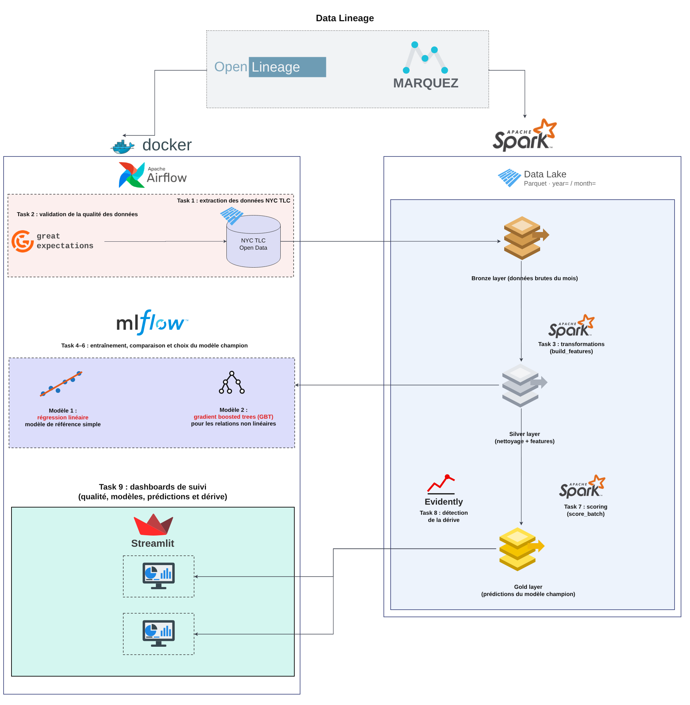

<br>

| Component              | Technology                       | Purpose                                                        |
|------------------------|----------------------------------|----------------------------------------------------------------|
| Orchestration          | Apache Airflow 2.11 (LocalExecutor) | Schedule & coordinate the 11 tasks of the pipeline          |
| Data Processing        | Apache Spark 3.5 (local mode)    | Ingestion, cleaning and feature engineering                    |
| Data Lake              | Parquet — Medallion architecture | Bronze (raw) → Silver (clean + features) → Gold (predictions)  |
| Data Quality           | Great Expectations 1.24          | 18 validation rules on every new month                         |
| Machine Learning       | Spark MLlib                      | Linear Regression + Gradient Boosted Trees                     |
| Experiment Tracking    | MLflow 3.17                      | Metrics, models, Model Registry with a `champion` alias        |
| Drift Monitoring       | Evidently 0.7                    | Data drift between training month and new month               |
| Data Lineage           | OpenLineage + Marquez 0.51       | End-to-end data flow tracking & impact analysis                |
| Dashboard              | Streamlit + Plotly               | Quality, models, predictions and drift KPIs                    |
| Metadata Database      | PostgreSQL 16                    | Airflow state                                                  |
| Containerization       | Docker Compose                   | One-command deployment of all 7 services                       |

---

## 🔄 Pipeline (Airflow DAG `taxiflow_pipeline`)

```
ingest_month → validate_raw → build_features → train_model → compare_models → decide_deploy
                                                                                  ├── promote_model ──┐
                                                                                  └── keep_champion ──┴→ score_batch → monitor_drift → publish_kpis
```

| # | Task             | What it does                                                                        |
|---|------------------|-------------------------------------------------------------------------------------|
| 1 | `ingest_month`   | Downloads the month from NYC TLC open data (if missing) and writes it to **Bronze** |
| 2 | `validate_raw`   | Runs **18 Great Expectations rules** — stops the pipeline if quality is too low     |
| 3 | `build_features` | Cleans the data and builds the features (hour, day, airport, boroughs…) → **Silver** |
| 4 | `train_model`    | Trains Linear Regression + GBT with Spark MLlib, logs everything in MLflow          |
| 5 | `compare_models` | Evaluates challenger vs champion on the **same** test set                           |
| 6 | `decide_deploy`  | Branching: promote the challenger or keep the champion                              |
| 7 | `promote_model`  | Moves the `champion` alias to the new version                                       |
| 8 | `keep_champion`  | Keeps the current production model                                                  |
| 9 | `score_batch`    | The champion predicts every trip of the month → **Gold**                            |
| 10 | `monitor_drift` | Evidently drift report vs. the champion's training month                            |
| 11 | `publish_kpis`  | Aggregates Gold predictions into small JSON files for the dashboard                 |

The month to process is a **DAG parameter** (`month = YYYY-MM`) chosen when triggering the run.

---

## 📸 Interface Previews

### 1. Airflow (Orchestration)
> *Airflow coordinates the 11 tasks of the pipeline. With **Show datasets** enabled, the graph also displays the datasets read and written by each task: Bronze, Silver and Gold zones, the MLflow model and the reports. On this successful run every task is green; only one branch of the champion / challenger decision runs, the other one is skipped (pink).*

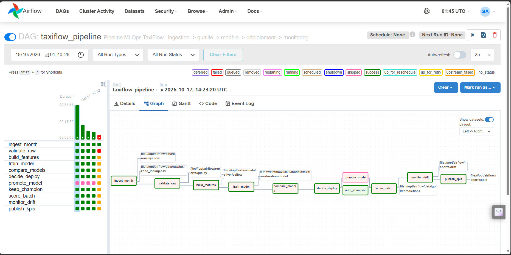

### 2. Quality Gate in Action (Corrupted Month)
> *The corrupted month `2024-08` (negative fares, zero distances, trips ending before they start) is stopped at `validate_raw` (red). All downstream tasks stay orange (`upstream_failed`): no model is trained on bad data and the production model stays untouched.*

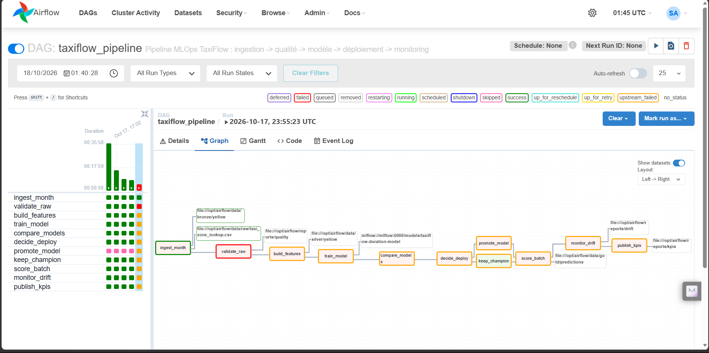

### 3. Marquez (Data Lineage)
> *Every Airflow task sends an OpenLineage event to Marquez, which rebuilds the full lineage graph of the `taxiflow` namespace: from the NYC TLC source (`trip-data/yellow...`) and the zone lookup table, through the Bronze, Silver and Gold zones and the MLflow model registry, to the quality and drift reports. Failed jobs appear in red.*

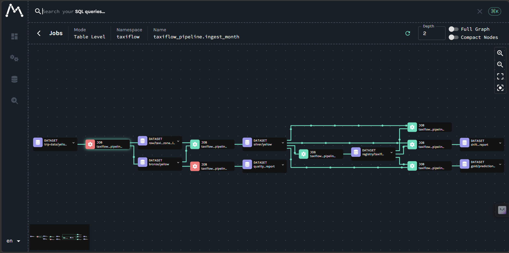

### 4. MLflow (Model Tracking)
> *Each month, the two Spark MLlib models are logged in the `taxiflow-duration` experiment with their parameters and metrics. Comparing the two runs of April 2024: the GBT (`maxDepth=6`, `maxIter=30`) reaches a MAE of 3.78 min, against 5.13 min for the Linear Regression (`maxIter=50`, `regParam=0.1`).*

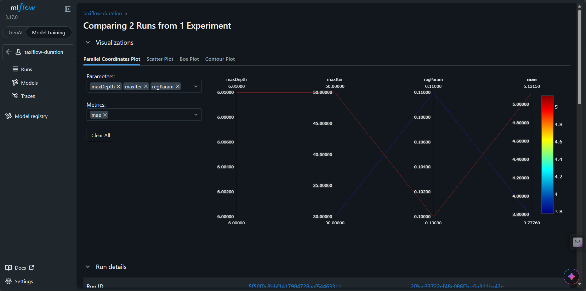

> *Runs can also be compared across months. Here, the GBT trained on January 2024 (MAE 3.30 min, R² 0.78) against the Linear Regression trained on February 2024 (MAE 4.63 min, R² 0.67), with the parameters, features and training sizes logged for each run.*

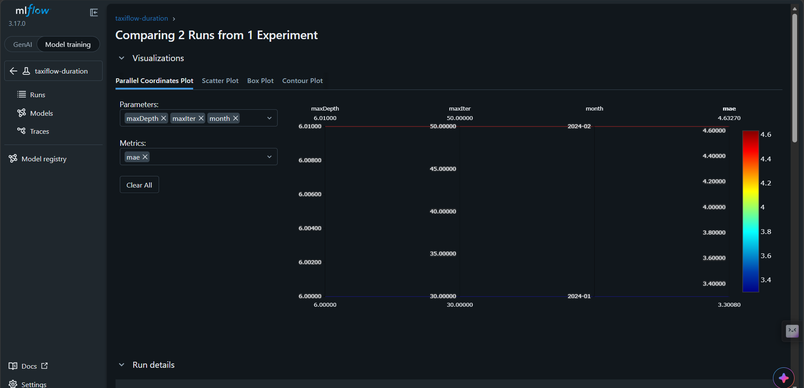
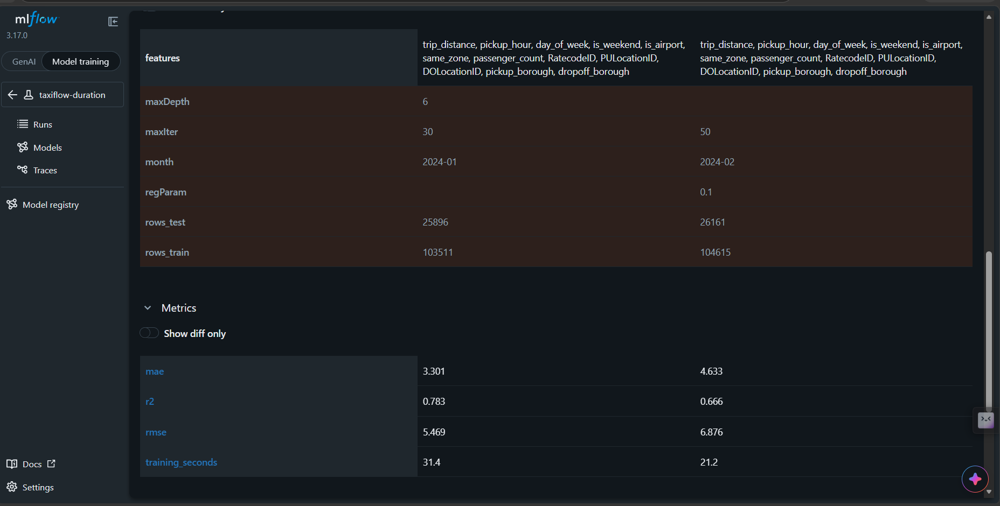

### 5. Streamlit Dashboard (KPIs)

**Overview** — *trips of the month, share of valid trips, model error and production version; trips and average duration by pickup hour, departures by borough and trips by day of the week (January 2024).*

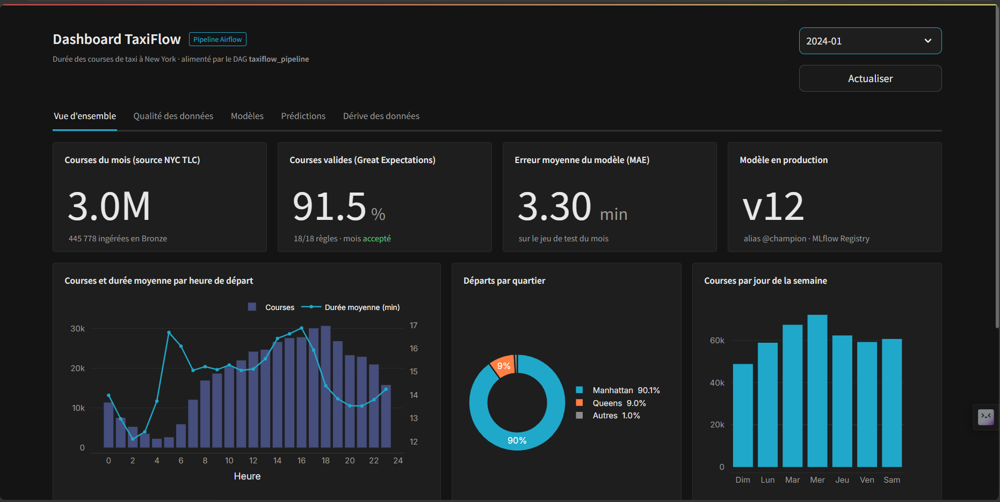

*The run history lists every processed month: quality verdict, valid trips, best model, MAE, deployment decision and drift status. The corrupted month `2024-08` is **blocked**.*

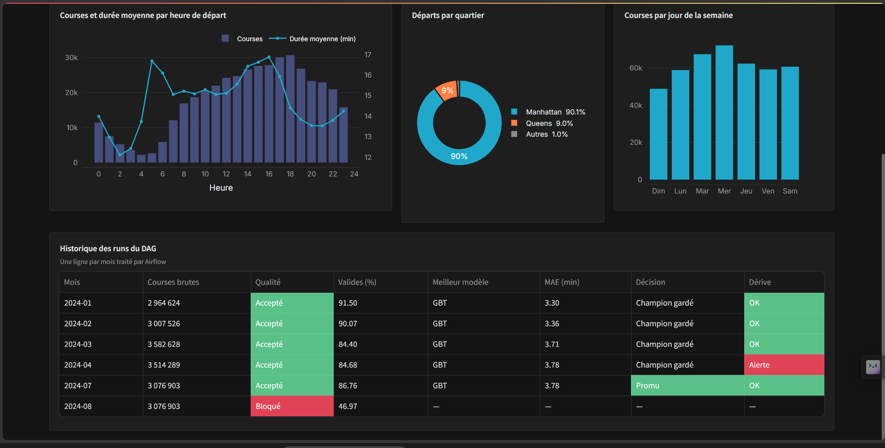

**Data Quality** — *error rate per rule and share of valid trips per month (the blocked month in red), then the detail of the 18 Great Expectations rules.*

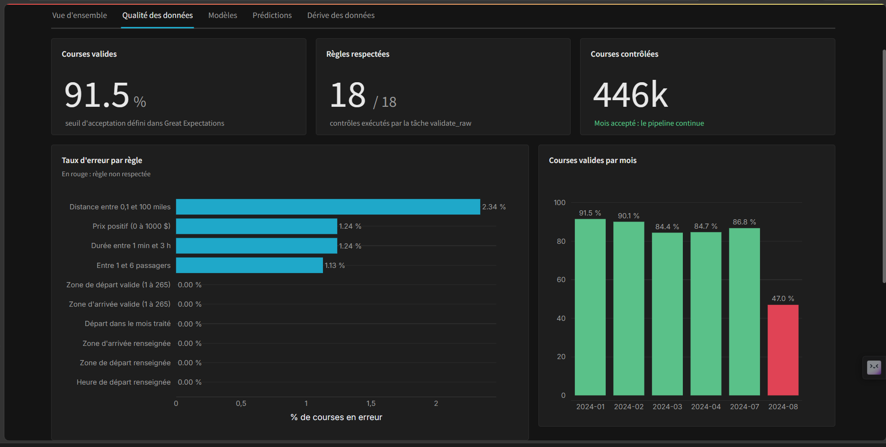
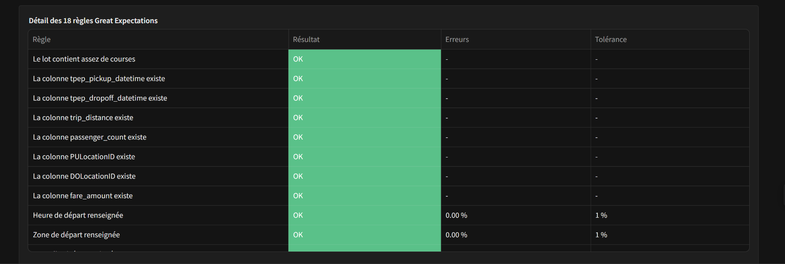

**Models** — *best model of the month (GBT), its MAE, RMSE and R², and the comparison Linear Regression vs GBT for every month.*

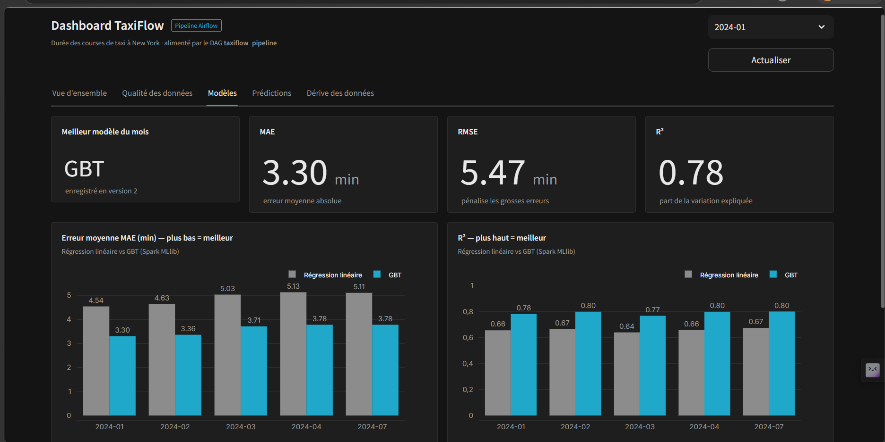

**Predictions** — *real vs predicted trip duration by pickup hour: the two curves almost overlap.*

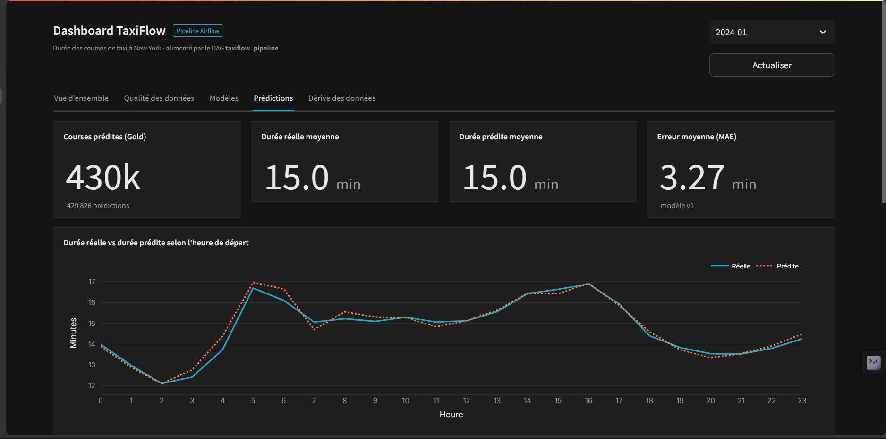

**Data Drift** — *drifted variables, share of drifted variables per month against the 25 % alert threshold, and the Evidently drift score of each variable.*

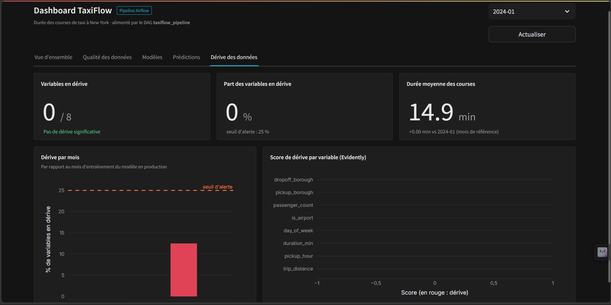

**Blocked month** — *for `2024-08`, the dashboard shows 15/18 rules passed, only 47 % valid trips, and no KPIs: the pipeline stopped before training.*

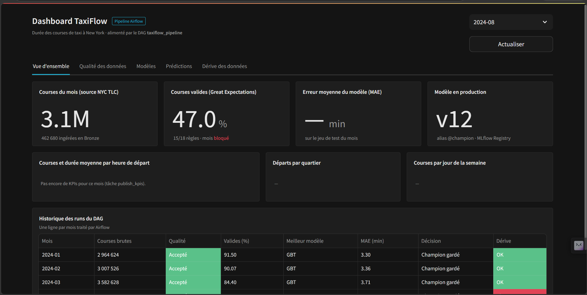

---

## 🚀 Quick Start

### Prerequisites

- **Docker Desktop** (with WSL 2 on Windows) — 8 GB RAM minimum, 5 GB allocated to Docker
- **~20 GB** of free disk space (images ≈ 13 GB)
- **Git**
- An internet connection (the pipeline downloads the NYC TLC files automatically)

### Step 1 — Clone the repository

```bash
git clone https://github.com/Salma1799/End-to-end-mlops-pipeline-airflow.git taxiflow
cd taxiflow
```

> ⚠️ Clone into a folder named `taxiflow` (as above): Docker Compose uses the folder name for image names, and the dashboard image is built on top of the `taxiflow-airflow` image.

### Step 2 — Build the images

```bash
docker compose build airflow            # first: the Airflow image (Java + Spark + libraries)
docker compose --profile lineage build  # then: MLflow, dashboard
```

The first build takes 15–30 minutes.

### Step 3 — Launch the platform

```bash
docker compose --profile lineage up -d
docker compose ps        # 7 services should be "Up"
```

> Without `--profile lineage`, the pipeline runs exactly the same, only without Marquez.

### Step 4 — Access the UIs

| Service         | URL                       | Credentials        |
|-----------------|---------------------------|--------------------|
| **Airflow**     | http://localhost:8080     | `admin` / `admin`  |
| **MLflow**      | http://localhost:5000     | No auth required   |
| **Dashboard**   | http://localhost:8501     | No auth required   |
| **Marquez UI**  | http://localhost:3000     | No auth required   |
| **Marquez API** | http://localhost:5002     | No auth required   |

### Step 5 — Run the pipeline

1. In Airflow, open **DAGs** → `taxiflow_pipeline` and toggle it **ON**
2. Click **Trigger DAG** and enter a month, e.g. `2024-01`
3. Follow the run in the **Graph** tab (≈ 15–25 min per month on an 8 GB laptop)
4. Repeat with `2024-02`, `2024-03`… to see the champion / challenger decisions

### Step 6 — Test the quality gate

```bash
docker compose exec airflow python /opt/airflow/scripts/corrupt_data.py
```

Then trigger the DAG with `month = 2024-08`: `validate_raw` turns **red** and the pipeline stops.

---

## 🔥 Quality Gate Strategy

| Month       | Data                                    | Detected By             | Pipeline Effect                                        |
|-------------|-----------------------------------------|-------------------------|--------------------------------------------------------|
| **Normal**  | Real NYC TLC data                        | Great Expectations (18/18 ✅) | ✅ Training, deployment decision, scoring, monitoring |
| **Corrupted** (`2024-08`) | 25 % negative fares, 20 % zero distances, 10 % negative durations | Great Expectations ❌ | ❌ DAG stops at `validate_raw` → Marquez shows **FAILED** |
| **Drifted** | Distribution change vs. training month   | Evidently               | ⚠️ Drift alert in logs, reports, MLflow and dashboard  |

---

## 📁 Project Structure

```
taxiflow/
├── dags/
│   └── taxiflow_pipeline.py      # Airflow DAG (11 tasks, champion/challenger branching)
├── src/
│   ├── ingest.py                 # Task 1: NYC TLC download + Bronze zone
│   ├── validate.py               # Task 2: Great Expectations (18 rules)
│   ├── features.py               # Task 3: cleaning + features → Silver zone
│   ├── train.py                  # Task 4: Spark MLlib + MLflow
│   ├── deploy.py                 # Tasks 5–9: champion/challenger + Gold zone
│   ├── monitor.py                # Task 10: Evidently drift monitoring
│   ├── kpis.py                   # Task 11: dashboard KPIs
│   ├── lineage.py                # Datasets declared for OpenLineage / Airflow
│   └── spark_utils.py            # Lightweight local Spark session
├── scripts/
│   ├── corrupt_data.py           # Builds the corrupted month 2024-08
│   └── apercu_donnees.py         # Preview of a raw monthly file
├── dashboard/
│   ├── app.py                    # Streamlit dashboard (5 tabs)
│   ├── Dockerfile
│   └── .streamlit/config.toml
├── mlflow/Dockerfile             # MLflow tracking server
├── docs/                         # Installation guides (PDF) + draw.io architecture
├── images/                       # README screenshots
├── data/                         # Data lake (raw / bronze / silver / gold) — not versioned
├── reports/                      # Pipeline reports (JSON / HTML) — not versioned
├── docker-compose.yml            # 7-service orchestration
├── Dockerfile                    # Airflow image (Java + Spark + libraries)
└── requirements.txt
```

---

## 📊 Data Quality Checks

### Source Validation (Great Expectations — Bronze zone)

| Rule | Column | Tolerance (`mostly`) |
|------|--------|----------------------|
| Batch has at least 100,000 trips | — | 100 % |
| Required columns exist (7 rules) | pickup / dropoff time, distance, passengers, zones, fare | 100 % |
| Pickup time and zones are not null (3 rules) | `tpep_pickup_datetime`, `PULocationID`, `DOLocationID` | 99 % |
| Pickup inside the processed month | `tpep_pickup_datetime` | 99 % |
| Duration between 1 min and 3 h | `duration_min` | 95 % |
| Distance between 0.1 and 100 miles | `trip_distance` | 95 % |
| Between 1 and 6 passengers | `passenger_count` | 85 % |
| Fare between 0 and 1000 $ | `fare_amount` | 95 % |
| Valid pickup / dropoff zones (1–265) (2 rules) | `PULocationID`, `DOLocationID` | 99 % |

### Model Evaluation (MLflow)

| Metric | Meaning |
|--------|---------|
| **MAE** | Mean absolute error in minutes — used to choose the best model |
| **RMSE** | Penalizes large errors |
| **R²** | Share of the variance explained |

A challenger replaces the champion only if its MAE is lower by at least `MIN_IMPROVEMENT_MINUTES` (0.05 min by default).

---

## 🔧 Useful Commands

```bash
# Follow Airflow logs
docker compose logs -f airflow

# Preview a raw monthly file
docker compose exec airflow python /opt/airflow/scripts/apercu_donnees.py 2024-01

# Check the Marquez API
curl http://localhost:5002/api/v1/namespaces

# Stop everything (keeps all data)
docker compose --profile lineage stop

# Remove containers (keeps volumes)
docker compose --profile lineage down

# Fresh start (also deletes Airflow history, MLflow models and lineage)
docker compose --profile lineage down -v
```

> 💡 On an 8 GB laptop, training runs on 15 % of the Silver data (`TRAIN_SAMPLE_FRACTION` in `docker-compose.yml`). Lower it if training is too slow.

---

## 📈 Observability UIs Guide

### Airflow (Orchestration)
- **Purpose**: Trigger months, monitor task execution, read logs, retry failed tasks
- **Best for**: Debugging, checking the branching decision of each month

### MLflow (Experiment Tracking)
- **Purpose**: Compare Linear Regression vs GBT, browse model versions
- **How to use**: Experiment `taxiflow-duration` → select two runs → **Compare**; tab **Models** → `taxiflow-duration-model` to see the `champion` alias

### Marquez (Data Lineage)
- **Purpose**: Trace data flow across the entire pipeline
- **How to use**: Namespace `taxiflow` → **Jobs** → `taxiflow_pipeline.publish_kpis` → enable **Full Graph**

### Streamlit (Dashboard)
- **Purpose**: Quality, model, prediction and drift KPIs per month
- **How to use**: Select the month → browse the 5 tabs → **Actualiser** after a new run

---

## 📚 Documentation

- [`docs/Airflow_Guide_installation.pdf`](docs/Airflow_Guide_installation.pdf) — Apache Airflow installation guide with Docker Compose
- [`docs/TaxiFlow_Guide_installation.pdf`](docs/TaxiFlow_Guide_installation.pdf) — step-by-step guide to build and run TaxiFlow
- [`docs/architecture_taxiflow.drawio`](docs/architecture_taxiflow.drawio) — editable architecture diagram (open with [draw.io](https://app.diagrams.net))

---

## 👩‍💻 Author

**Salma Bouziane Ouaritini** — Engineering student, Information Systems & Big Data (ISIBD), ENSA Berrechid
Supervised by **Pr. Lamia Karim** — *Big Data & Applications* module, 2026–2027

## 📝 License

This project was built as an academic demonstration of MLOps practices. Data: [NYC Taxi & Limousine Commission — TLC Trip Record Data](https://www.nyc.gov/site/tlc/about/tlc-trip-record-data.page).
